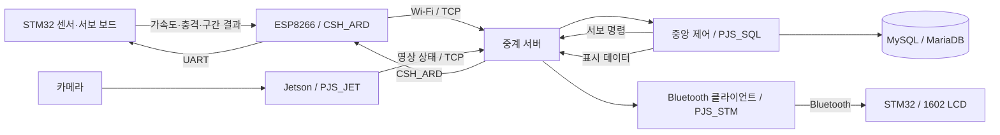

# 🏢 건물 지진 모니터링 시스템 (Earthquake Monitoring System for Buildings)

건물 모형의 **기둥 기울임과 진동을 함께 관측하고, 관제 결과에 따라 서보 모터를 제어하는 시스템**입니다. STM32의 가속도·충격 센서, Jetson의 카메라 기반 상태 분류, TCP 중계 서버와 중앙 제어 클라이언트를 연결해 센서 수집부터 통합 판정·기록·상태 표시까지 구현했습니다.

센서 보드는 약 **10ms 간격으로 가속도를 수집**하고, 최근 구간의 **최대–최소 차이(P2P)와 RMS**를 계산합니다. 중앙 제어 클라이언트는 이를 영상 상태와 결합해 `SAFETY / CAUTION / WARNING` 단계를 결정합니다.

> 관제 단계는 모형과 입력 데이터를 대상으로 한 규칙 기반 이상 판정입니다. 실제 지진 원인 확정이나 검증된 건물 보호 성능을 의미하지 않습니다.
> 

---

## 👥 팀원 및 역할 분담 (Team Roles)

| 팀원 | 담당 역할 |
| --- | --- |
| **박진성** | 서버 및 중앙 제어 클라이언트, 기둥 기울임 감지 구현, 센서 보드 최적화 |
| **최선호** | 센서 + 서보 보드 구현, 블루투스 데이터 표시 보드 구현 및 클라이언트 구현 + 프로토타입 설계, 제작 및 보드 설정 |

---

## 🔗 시스템 구성 (System Architecture)



| 구성 요소 | 역할 |
| --- | --- |
| STM32 센서·서보 보드 | MPU6050·SHOCK 읽기, P2P/RMS 계산, 서보 8개 제어 |
| ESP8266 | 센서 보드의 UART와 Wi-Fi/TCP 통신 |
| Jetson 영상 클라이언트 | 카메라 전처리, Keras 모델 추론, 상태 전송 |
| TCP 중계 서버 | 로그인 ID와 목적지 ID를 기준으로 메시지 전달 |
| 중앙 제어 클라이언트 | 통합 점수 판정, 서보 명령, DB 저장 |
| Bluetooth 표시 경로 | 중앙 판정과 가속도·SHOCK 값을 LCD에 표시 |

**현재 센서 경로:** `STM32 → ESP8266(CSH_ARD로 로그인) → 중계 서버 → PJS_SQL`

현재는 보드 자체가 `CSH_ARD` ID로 로그인합니다. `hardware/iot_client.c`는 수동 TCP 클라이언트이며, 별도 프로그램을 경유하는 센서 게이트웨이는 아직 구현하지 않았습니다.

---

## 🛠 하드웨어 구성 및 핀 맵 (Hardware Setup & Pinmap)

STM32 NUCLEO-F411RE 기반의 **센서·서보 보드와 Bluetooth·LCD 표시 보드**를 사용합니다. 아래 핀은 HAL 초기화 코드 기준입니다. UART는 TX와 RX를 교차 연결하고 각 연결 장치의 GND를 공통으로 구성합니다.

### 1. 센서·서보 보드

| 기능 | 주변장치 | 핀 / 설정 |
| --- | --- | --- |
| MPU6050 | I2C3 | `PA8` SCL, `PC9` SDA / 100kHz |
| SHOCK 입력 | GPIO | `PC0` |
| ESP8266 통신 | USART6 | `PC6` TX, `PC7` RX |
| 디버그 출력 | USART2 | `PA2` TX, `PA3` RX 설정 / 115200bps |
| 서보 1~4 | TIM3 CH1~CH4 | `PA6`, `PA7`, `PB0`, `PB1` |
| 서보 5~8 | TIM4 CH1~CH4 | `PB6`, `PB7`, `PB8`, `PB9` |

- ESP 통신은 초기 38400bps 설정 후 **115200 → 38400 → 9600bps** 순으로 응답 속도를 탐색합니다.
- 서보 PWM은 **20ms 주기**, 펄스 폭 **500~2500μs** 설정이며 LOCK은 0°, RELEASE는 180° 명령입니다.
- 전원 투입 시 Wi-Fi/TCP 연결과 RELEASE → LOCK 시험 동작 후 센서 기준값 보정을 시작합니다.

### 2. Bluetooth·LCD 표시 보드

| 기능 | 주변장치 | 핀 / 설정 |
| --- | --- | --- |
| I2C 1602 LCD | I2C1 | `PB8` SCL, `PB9` SDA / 100kHz / 주소 `0x27` |
| UART Bluetooth 모듈 | USART6 | `PC6` TX, `PC7` RX / 9600bps |
| 디버그 출력 | USART2 | `PA2` TX, `PA3` RX 설정 / 115200bps |

LCD에는 가속도(g), SHOCK 값과 최종 단계를 표시합니다. 단계 표시는 `S`(SAFETY), `C`(CAUTION), `W`(WARNING)입니다.

### 3. 영상 처리 장치

Jetson과 카메라를 사용합니다. `VideoCapture(0)`으로 영상을 얻고, RGB 변환·중앙 크롭·224×224 리사이즈·정규화 후 Keras 모델에 입력합니다. 기둥의 상태를 세 클래스로 분류하며, 각도 수치나 객체 좌표를 출력하지 않습니다.

---

## ✨ 주요 기능 (Key Features)

### 1. STM32 내부의 빠른 취득과 구간 기반 진동 감지

기존 **1초마다 순간값 하나를 읽는 방식**을 **빠른 취득과 요약 전송을 분리하는 방식**으로 개선했습니다.

1. 정지 상태의 초기 100개 샘플로 축별 기준값을 계산합니다.
2. 약 10ms마다 XYZ를 읽고, 기준값을 뺀 최근 20개 샘플을 유지합니다.
3. 축별 P2P와 RMS를 계산해 가장 큰 P2P와 가장 큰 RMS를 선택합니다.
4. P2P 또는 RMS가 기준을 넘으면 이상 후보를 다음 보고까지 보류합니다.
5. 정상/이상 변화는 최소 200ms 보고 간격을 적용하고, 같은 상태는 1초마다 보고합니다.

| 설정 | 현재 값 |
| --- | --- |
| 목표 수집 주기 | 10ms / 약 100Hz |
| 이동 구간 | 최근 20개 샘플 / 목표 주기에서 약 200ms |
| P2P 이상 기준 | 2000 raw count 이상 |
| RMS 이상 기준 | 700 raw count 이상 |
| 수집 공백 | 30ms 초과 시 구간 무효화·다시 채움 |

**P2P는 가장 크게 오간 폭**, **RMS는 기준에서 벗어난 구간 전반의 크기**를 봅니다. 두 최대값은 서로 다른 축에서 나올 수 있습니다. 현재는 둘 중 하나만 기준을 넘어도 후보가 되며 추가 지속 시간 조건은 없습니다. 임계값은 실측 튜닝 대상입니다.

반복문 기반 수집이므로 고정 100Hz를 보장하지 않습니다. ESP 응답 대기 중에도 수집하지만 UART 송신·로그 출력 등에서 간격이 늘어날 수 있습니다. SHOCK은 보고 시점의 순간값을 읽습니다.

### 2. 카메라 기반 기둥 기울임 상태 분류

- `keras_model.h5`와 `labels.txt`로 `SAFETY / CAUTION / WARNING`을 분류합니다.
- 같은 클래스가 **5프레임 연속** 관측됐을 때 전송 대상으로 확정합니다.
- 확정 상태가 바뀌면 전송하고, 같은 상태는 안정 조건 아래 **1초 heartbeat**로 재전송합니다.
- 현재 `MIN_CONFIDENCE=0.0`이므로 저신뢰 결과를 거부하는 기준은 활성화돼 있지 않습니다.

### 3. 센서·영상 통합 점수 판정

| 입력 | 조건 | 점수 |
| --- | --- | --- |
| 영상 상태 | WARNING / CAUTION / SAFETY | 4 / 2 / 0 |
| SHOCK | 입력값 1 | 2 |
| 유효한 가속도 구간 | ABNORMAL=1 / 0 | 4 / 0 |
| 순간 가속도 fallback | 1g 대비 크기 차이 ≥1500 / ≥1000 / 그 미만 | 4 / 2 / 0 |

구간 정보가 유효하면 순간 가속도 점수를 중복해서 더하지 않습니다. 구형 메시지 또는 `VALID=0`이면 순간값 규칙으로 돌아갑니다. SHOCK의 `1=감지`는 현재 코드의 가정이며 모듈 극성 확인이 필요합니다.

| 총점 | 통합 단계 |
| --- | --- |
| 0~2 | SAFETY |
| 3~5 | CAUTION |
| 6 이상 | WARNING |

영상 SAFETY·SHOCK 미감지에서 구간 이상만 있으면 4점으로 CAUTION, 구간 이상과 SHOCK 감지가 함께 있으면 6점으로 WARNING입니다.

### 4. 서보 대기 정책과 원격 제어

중앙은 `SERVOS@LOCK`, `SERVOS@RELEASE` 명령을 센서 보드에 전달합니다.

- WARNING에서 RELEASE 대기를 시작하고 **3초 경과 조건**을 확인합니다.
- WARNING 이후 CAUTION이면 RELEASE 대기를 유지합니다.
- RELEASE 대기 중 SAFETY가 **2초 유지**되면 대기를 취소합니다.
- RELEASE 상태에서 SAFETY로 복귀하면 **5초 경과 조건**에 따라 LOCK 명령을 보냅니다.

시간 조건은 통합 처리 시 확인합니다. 독립 타이머가 아니므로 정확히 3초·5초에 구동되는 것을 보장하지 않으며, WARNING 3초 연속 유지 규칙과도 다릅니다.

### 5. DB 기록과 Bluetooth 상태 표시

- `sensor_logs`에 저장 시각, 가속도, SHOCK, 영상 상태, 서보 명령 각도를 기록합니다.
- SAFETY는 기본 3초 간격 또는 단계 변경 시 저장하고, CAUTION/WARNING은 통합 처리마다 저장합니다.
- DB 저장 성공 후 표시 데이터를 Bluetooth 경로로 전달합니다.
- DB의 `gyro_x/y/z`는 **가속도 raw 값**, `motor1~8`은 **명령 각도**입니다. 현재 통합 최종 단계와 P2P/RMS를 저장하는 컬럼은 없습니다.

---
## 시연 영상


---

## 📡 통신 메시지 (Message Protocol)

### 클라이언트 ID와 고정 타겟

현재는 송신 경로별 **타겟 ID가 소스 코드에 고정**돼 있습니다. 로그인 ID는 자신을 식별하고, 메시지의 `[목적지 ID]`는 데이터를 받을 클라이언트를 지정합니다. 서버 IP·포트는 접속할 중계 서버의 주소이며, 타겟 ID와는 별개입니다.

| 송신 주체 | 로그인 ID | 고정 타겟 | 설정 위치 |
| --- | --- | --- | --- |
| 센서 보드 / ESP8266 | `CSH_ARD` | `PJS_SQL` — 센서 데이터 | 로그인은 `esp.h`의 `LOGID`, 타겟은 센서 `main.c`의 메시지 문자열 |
| Jetson 영상 클라이언트 | `PJS_JET` | `PJS_SQL` — 영상 상태 | `detect_earthQuake.py`의 `LOGIN_ID`, `CLIENT_ID` |
| 중앙 제어 클라이언트 | 실행 인자로 지정, 기본 실행 예는 `PJS_SQL` | `CSH_ARD` — 서보 명령 / `PJS_STM` — 표시 데이터 | `central_client.c`의 `SENSOR_CLIENT_ID`, `BT_CLIENT_ID` |
| Bluetooth 클라이언트 | 실행 인자로 지정, 기본 실행 예는 `PJS_STM` | 서버에서 받은 메시지를 연결된 Bluetooth 장치에 전달 | `bluetooth_client.c`의 실행 인자와 장치 주소 |

중계 서버 자체는 `PJS_SQL` 같은 특정 타겟을 하드코딩하지 않습니다. 로그인 ID 목록으로 인증한 뒤 메시지에 적힌 목적지와 일치하는 접속 클라이언트로 전달합니다. 그 목적지가 접속하지 않았다면 일반 중계 메시지를 보관했다가 재전송하지 않습니다.

예를 들어 보드가 `[PJS_SQL]SENSOR@...`를 보내면 `PJS_SQL`로 로그인한 중앙 클라이언트가 받아야 합니다. 중앙을 다른 ID로 실행하는 것만으로는 센서·영상의 고정 타겟이 바뀌지 않습니다. ID를 변경할 때는 **송신 코드의 타겟, 수신 프로그램의 로그인 ID, 서버 `idpasswd.txt` 등록 정보**를 함께 맞춰야 합니다.

### 메시지 형식

`[목적지 ID]명령@필드...\n` 형태로 송신하며, 중계 서버는 앞부분을 **발신자 ID**로 바꿔 전달합니다. 아래 `\n`은 실제 개행을 뜻합니다.

```text
# 센서 보드 → 중계 서버 → 중앙
송신: [PJS_SQL]SENSOR@AX@AY@AZ@SHOCK@P2P@RMS@ABNORMAL@VALID\n
수신: [CSH_ARD]SENSOR@AX@AY@AZ@SHOCK@P2P@RMS@ABNORMAL@VALID\n

# 영상 클라이언트 → 중앙
[PJS_SQL]STATUS@WARNING\n

# 중앙 → 센서 보드
[CSH_ARD]SERVOS@RELEASE\n
[CSH_ARD]SERVOS@LOCK\n

# 중앙 → Bluetooth 표시 경로
[PJS_STM]SENSOR@AX@AY@AZ@SHOCK@LEVEL\n
```

`ABNORMAL`은 이상 후보 여부, `VALID`는 초기 보정과 구간 계산 완료 여부입니다. P2P/RMS는 반올림한 raw count 정수입니다.

---

## 📂 프로젝트 구조

```text
.
├── hardware/
│   ├── earthquake_detection/       # 센서·서보 STM32 프로젝트
│   │   └── Core/Inc/vibration_detector.h
│   └── iot_client.c                # 수동 TCP 클라이언트
├── detect/                        # 영상 추론 코드·모델·라벨
├── SERVER/                        # TCP 중계 서버·로그인 ID 목록
├── SQLClient/                     # 중앙 판정·DB 저장·서보 명령
├── bluetooth/
│   ├── bluetooth_client.c         # TCP ↔ Bluetooth 연결
│   └── earthquake_detection_bt/   # LCD 표시 STM32 프로젝트
├── tests/                         # 구간 계산 독립 C 테스트
├── docs/                          # 구현·기술 선택·트러블슈팅 문서
└── output/presentations/           # 기존 발표 자료
```

---

## ▶️ 실행 방법 (Getting Started)

### 1. 환경과 설정 확인

- **STM32:** STM32CubeIDE에서 각 보드 프로젝트를 빌드하고 업로드합니다. Debug 산출물은 Git 추적에서 제외됩니다.
- **Linux C 프로그램:** GCC, pthread, MySQL/MariaDB 개발 라이브러리, BlueZ 개발 라이브러리가 필요합니다.
- **영상 프로그램:** Python, TensorFlow/Keras, NumPy, Pillow, OpenCV와 카메라 실행 환경이 필요합니다. 버전은 실행 장치에 맞춰 확인합니다.
- **DB:** `sensor_data` 데이터베이스와 코드가 사용하는 `sensor_logs` 테이블을 먼저 준비합니다. 자동 생성·마이그레이션 스크립트는 포함돼 있지 않습니다.

| 설정 | 파일 |
| --- | --- |
| 보드 Wi-Fi·서버 주소·로그인 ID | [esp.h](hardware/earthquake_detection/Core/Inc/esp.h) |
| 서버 로그인 ID 목록 | [idpasswd.txt](SERVER/idpasswd.txt) |
| DB·점수·서보 대기 설정 | [central_client.c](SQLClient/central_client.c) |
| 영상 서버·모델·연속 판정 설정 | [detect_earthQuake.py](detect/detect_earthQuake.py) |
| Bluetooth 장치 주소 | [bluetooth_client.c](bluetooth/bluetooth_client.c) |
| 샘플링·P2P/RMS 기준 | [vibration_detector.h](hardware/earthquake_detection/Core/Inc/vibration_detector.h) |

현재 기본 서버 주소는 `10.10.16.74:5000`입니다. 실행 환경에 맞게 장치와 클라이언트의 설정을 일치시킵니다.

### 2. 중계 서버 실행

```bash
cd SERVER
make
./iot_server 5000
```

서버는 실행 디렉터리의 `idpasswd.txt`를 읽습니다.

### 3. 중앙 클라이언트 실행 — 별도 터미널

```bash
cd SQLClient
bash build.sh
./central_client 10.10.16.74 5000 PJS_SQL
```

### 4. Bluetooth 클라이언트 실행 — 별도 터미널

```bash
cd bluetooth
gcc bluetooth_client.c -o bluetooth_client -pthread -lbluetooth
./bluetooth_client 10.10.16.74 5000 PJS_STM
```

표시 보드를 켜고 Bluetooth 주소를 실제 연결할 모듈에 맞춥니다.

### 5. 영상 클라이언트와 센서 보드 시작

Jetson에서 실행합니다. 모델·라벨 경로가 현재 디렉터리 기준이므로 `detect`에서 시작합니다.

```bash
cd detect
python3 detect_earthQuake.py
```

센서 보드는 Wi-Fi/TCP 연결, 서보 시작 시험, 정지 기준 보정 후 수집·보고를 시작합니다. **초기 100개 샘플 보정 중에는 센서를 정지시킵니다.**

### 6. 계산 모듈 테스트

저장소 루트에서 실행합니다.

```bash
cc -std=c11 -Wall -Wextra -Werror \
  -Ihardware/earthquake_detection/Core/Inc \
  tests/vibration_detector_test.c -lm -o /tmp/vibration_detector_test
/tmp/vibration_detector_test
```

정지 기준 제거, P2P/RMS, 구간 복구, 정수 극값, 수집 공백과 tick wraparound 등을 확인합니다. 실제 센서·네트워크·서보 통합 시험과 별개입니다.

---

## 🚀 트러블슈팅 (Troubleshooting)

### 1. 1초 순간 취득으로 중간 흔들림을 놓치는 문제

- **문제:** 전송 시점의 값이 정상과 비슷하면 그 사이의 양·음 흔들림이 관제에 남지 않습니다.
- **개선:** 약 10ms 취득과 최근 20개 샘플의 P2P/RMS 계산을 적용하고 짧은 이상 후보를 다음 보고까지 보류합니다.
- **확인할 점:** 고정 100Hz 보장과 실제 미탐 감소율은 부하·진동 실험으로 검증해야 합니다.

### 2. 빠른 전송과 제어 수신의 충돌

- **문제:** 개선 전에는 100ms 전송이 제어 수신을 방해해 취득·전송을 1초로 늦췄습니다.
- **개선:** 취득과 전송을 분리하고 ESP 응답 대기 중에도 센서를 읽습니다.
- **남은 부분:** UART 송신·로그 출력의 블로킹, 전송 성공 확인·재시도는 후속 개선 대상입니다.

### 3. 순간 가속도 크기만으로 수평 진동을 놓치는 문제

- **문제:** XYZ 전체 크기와 1g 차이만 보면 방향 변화와 일부 수평 진동이 작게 계산될 수 있습니다.
- **개선:** 유효한 구간 결과를 우선 판정하고 순간값 규칙은 호환용 fallback으로 유지했습니다.
- **남은 부분:** 큰 단발 충격도 후보가 될 수 있어 지속 시간·복귀 기준과 임계값 튜닝이 필요합니다.

### 4. 영상 분류의 배경 의존성과 필터 선택

- **현재 상태:** 전체 프레임 중앙 크롭을 사용하므로 배경·조명·카메라 움직임이 영향을 줄 수 있습니다. 소프트웨어 FIR/IIR은 추가하지 않았습니다.
- **후속 방향:** 기둥 ROI와 배경별 학습·평가를 검토하고, 같은 원본 신호로 필터 적용 전후의 미탐·오탐·지연을 비교합니다. 구간 계산도 시간 반응에 영향을 주므로 무지연을 주장하지 않습니다.

상세한 분석과 적용 범위는 아래 문서를 참고하세요.

- [STM32 구간 기반 진동 감지 구현](docs/vibration-detector-implementation.md)
- [기술 선택 및 전체 트러블슈팅](docs/troubleshooting-and-technical-decisions.md)
- [문제 상황과 후속 해결 방안](docs/problem-scenarios-and-solutions.md)
- [센서 트러블슈팅 발표 흐름](docs/troubleshooting-presentation-flow.md)

---

## 🔮 향후 발전 방향 (Future Work)

- **CSH_ARD 게이트웨이:** `STM32 → ESP8266 → 별도 CSH_ARD 프로그램 → 중계 서버 → PJS_SQL` 경로와 역방향 명령 전달 구현.
- **수집 주기 개선:** 타이머/data-ready·DMA 등을 통한 실제 간격과 누락 관리 강화.
- **오탐 제어:** 단발 충격·지속 진동 비교, 진입·복귀 기준과 지속 시간 검증.
- **시간 정렬·장애 처리:** 원본 측정 시각·송신 순번, 영상 미수신·만료 상태, SHOCK 이벤트 보관 추가.
- **통신·기록 분리:** 중계 서버 개행 프레이밍·부분 송신 처리, 전송 확인·재접속, DB 지연과 표시 경로 분리.
- **영상 개선:** 고정 ROI, 배경별 평가, 신뢰도 조건과 불확실 상태 도입.
- **검증·기록 확대:** 정상·충격·진동·기울임·단절 실험과 구간 지표·최종 단계 저장 확장.
